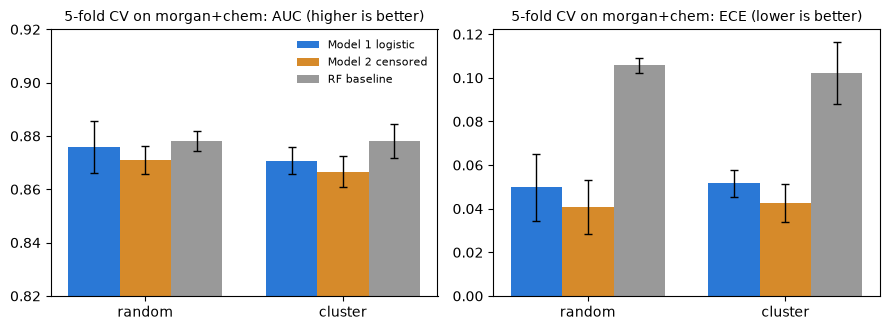

# Will It Fly? Predicting Echo-MS detectability from chemical structure

CSE 5015 course project · Arno Yu

A mass spectrometer only weighs molecules that carry a charge. In positive-ion mode a compound
has to pick up a proton to be seen at all, and whether it does is a property of its structure:
basic nitrogens help, acids hurt. A compound that gives a clear peak is said to **fly**.

This project predicts flying from structure as a *calibrated probability* — not just a ranking,
but a number a chemist can act on, with uncertainty that is honest about what the model does
not know. Three Bayesian models, one dataset of 11,353 compounds measured on an Echo-MS.

### What we found

1. **Every model ranks about equally well** — AUC 0.85–0.89, and cross-validation shows the
   differences between them are inside fold-to-fold noise.
2. **They are not equally honest.** A random forest's calibration error is 0.106; the Bayesian
   models' are 0.041 and 0.050, and the gap holds in 10 folds out of 10.
3. **The GP's uncertainty does not mark its mistakes**, so it cannot serve as the applicability
   domain the proposal assumed. How far the predicted probability sits from 0.5 does work.
4. **ARD matters when there is dead weight.** On 50 chosen features it changes nothing; on 2,048
   fingerprint bits it is worth +0.037 AUC, the largest single gain in the project.

So: these models do not predict better than a forest. They predict about as well and they know
what they know — which is what a screen deciding where to spend instrument time actually needs.

---

## Choosing the features first

A model can only be as good as what it is shown, so the cheap model went first: a random forest
over every combination of three feature blocks — 50 interpretable chemistry features (SMARTS
counts for ionisable groups plus RDKit descriptors), 41 XenoSite phase1 descriptors from the
Swamidass lab, and 2048-bit Morgan fingerprints.

| Feature set | Columns | AUC (random) | AUC (cluster) |
|---|---|---|---|
| phase1 | 41 | 0.834 | 0.819 |
| chemistry | 50 | 0.846 | 0.838 |
| Morgan | 2048 | 0.863 | 0.838 |
| chemistry + phase1 | 87 | 0.862 | 0.844 |
| **Morgan + chemistry** | 2098 | **0.885** | **0.866** |
| all three | 2139 | 0.877 | 0.854 |

**Morgan + chemistry wins**, and the two blocks are complementary rather than redundant: the
fingerprints carry structure the descriptors cannot name, the descriptors carry ionisation
chemistry the fingerprints cannot express. Adding phase1 on top makes things worse — those
descriptors were built to predict *metabolism*, which atom a liver enzyme attacks, and say
nothing about whether a molecule holds a proton. (Method notes revisit how safe that screen is.)

So Morgan + chemistry is the feature set to beat, and where it can be used it is what the
models below are given. Model 3 is the exception: a Tanimoto kernel is defined on bit vectors,
so continuous descriptors cannot enter it at all.

---

## Results

Five-fold cross-validation on Morgan + chemistry, the feature set the screen chose. Higher is
better for AUC, lower for ECE.

| Model | AUC | ECE |
|---|---|---|
| Random forest | 0.878 ± 0.004 | 0.106 ± 0.003 |
| Model 1 — Bayesian logistic regression | 0.876 ± 0.010 | 0.050 ± 0.016 |
| Model 2 — censored (Tobit) regression | 0.871 ± 0.005 | **0.041 ± 0.012** |



**On AUC the error bars overlap; on ECE they do not come close.** That is the whole result.
Pairing fold by fold, Model 1 beats the forest on calibration in 10 folds out of 10 and on
ranking in only 3.

**ECE** (expected calibration error) is the average gap between the probability a model
announces and the frequency it achieves. 0.04 means that when the model says 70%, the truth is
within about four points. AUC cannot measure this — it only sees ranking, and a forest's vote
share is not a probability at all.

Two things are worth noticing. **Model 2 is the best calibrated** even though it ranks last:
modelling the peak area and deriving a probability from it beats modelling the yes/no answer
directly. And **a single split would have misled us** — on one split Model 1 looked 0.006 ahead
of the forest on AUC, where ten folds put the forest 0.005 ahead. The spread is twice either
number, so that difference was never real.

Model 3 is absent here because a Tanimoto kernel only accepts bit vectors, so it cannot be given
this feature set. On Morgan fingerprints alone it ranks best of the four (AUC 0.879) and
calibrates worst (ECE 0.072) — the finding in §2 below. Per-model numbers on every feature set
are in [the method notes](#every-feature-set).

---

## Three findings

### 1. The chemistry the model learns is the chemistry we expected


Model 1's coefficients with 95% credible intervals. Basic nitrogens, lipophilicity and sp³
character push a molecule towards flying; hydrogen-bond donors and carboxylic acids push against
it. That is the textbook account of positive-mode ionisation, recovered from data.

The credible intervals carry information a point estimate cannot. `n_phosphonic_acid` spans
−2.2 to +1.5 — the library holds too few phosphonic acids to say anything about them. A random
forest would report an importance for that feature and give no hint that it is meaningless.

### 2. The GP is the worst-calibrated model of the three

On its own feature set Model 3 ranks well — 0.879 AUC, the best of anything fitted on Morgan
fingerprints alone — but its ECE of 0.072 is nearly three times Model 1's, the worst of the
three models. The probabilities sit too close to 0.5 to be taken at face value.

The likely cause is the Laplace approximation for GP classification, which is known to
understate the magnitude of the latent function.

### 3. The applicability-domain claim does not survive contact with the data


**How to read this**, right to left: *I can only afford to run some of these compounds — can the
model tell me which calls to trust?* At the right edge nothing is discarded, and accuracy is
80%. Moving left keeps only the predictions the model is most sure of. **A trust signal that
works makes the line climb.**

The proposal assumed GP variance would be that signal — unfamiliar molecule, larger variance,
less trustworthy prediction. **It is not.** The red line is flat: discarding the "uncertain"
nine tenths buys nothing, and variance correlates with error at −0.09 to −0.02 across four
splits. Variance does detect novelty; novelty just is not what makes a prediction wrong here.
Plausibly the strange molecules are strange *because* they carry an extreme group — a quaternary
ammonium always flies, a sulfonic acid never does — which makes them strange and easy at once.

**Distance from 0.5** (blue) does work, climbing to nearly 100%. Keeping the most confident
fifth gives about 97% accuracy against 60% for the least confident. The proposal's question —
*when should I trust this?* — has a good answer; it is not the one assumed.

The dataset limits what can be concluded either way. Clustering at 0.4 Tanimoto leaves 7,067
clusters among 11,353 compounds, 4,583 of them singletons, and random, cluster, scaffold and
deliberately-hard splits all land within 0.01 AUC of each other. **This library has no genuinely
out-of-domain corner to fail on.**

---

## Validation


Y-randomization: shuffle the training labels, refit, score against the real test labels, 25
times per split. The shuffled fits average 0.49 — chance — and the luckiest of 25 reaches 0.70,
while the real model scores 0.85–0.87. Four to five standard deviations clear. Whatever the
model learnt is in the labels, not in the plumbing.

**Laplace against MCMC.** Every number here comes from the fast approximation, so it was checked
against the slow one. Models 1 and 2 were fitted both ways — sixteen runs in all, with NUTS
(nutpie, 4 chains, 1000 draws) as the reference. The two agree to within 0.001 AUC, with **zero
divergences** and r̂ ≤ 1.006. Laplace takes a second; MCMC takes five minutes.

**ARD earns its place exactly where there is dead weight to remove.** Against a fixed Gaussian
prior, on the random split:

| Features | | Gaussian | ARD | |
|---|---|---|---|---|
| chemistry (50) | Model 1 | 0.868 / 0.456 | 0.868 / 0.455 | no difference |
| Morgan 2048 | Model 1 | 0.832 / 0.582 | 0.862 / 0.468 | **+0.030 AUC** |
| Morgan + chemistry | Model 1 | 0.854 / 0.574 | **0.891 / 0.418** | **+0.037 AUC** |
| Morgan + chemistry | Model 2 | 0.861 / 0.477 | 0.878 / 0.449 | +0.017 AUC |

(AUC / log loss.) On 50 hand-picked features nothing changes — none of them are useless. On
2,048 fingerprint bits, mostly noise for this task, learning a scale per feature is the largest
single gain in the project, and calibration moves further still (ECE 0.100 → 0.034). This is the
proposal's step 3, *ARD instead of stepwise selection*, doing what it was chosen for, at the
cost of one fit rather than hundreds.

ARD lifts Model 2 by less than half as much and it stays behind Model 1 on the same features, so
the censored model's gap is the model, not a missing prior. Running it at all needed an
**analytic Hessian**: by finite differences each fit took 80 s at d = 2098, which put a
twenty-round ARD fit at half an hour. Deriving it brought that to 0.7 s, matching finite
differences to 2e-11.

---

## Reproducing

Data is not in the repository. It is public, and the download script verifies MD5s:

```bash
python -m venv .venv
.venv/Scripts/activate                   # Windows;  source .venv/bin/activate elsewhere
pip install -r requirements.txt
python scripts/download_data.py          # Zenodo record 21450795
```

Then, in order:

```bash
python scripts/featurize.py              # 3 feature blocks, ~6 min
python scripts/add_hard_split.py         # scaffold and hard splits
python scripts/fit_model1.py             # Laplace + MCMC, ~25 min
python scripts/fit_model2.py
python scripts/fit_model3.py             # GP, ~30 min
python scripts/validate.py               # MCC, ECE, Y-randomization, CV
python scripts/export_figures.py
```

Only `featurize.py` needs anything extra: its XenoSite descriptor block reads ONNX weights from
`weights/onnx`, which are not public. The other two feature blocks, and all three models, run
without them. Every notebook is committed **with its outputs**, so all figures and tables can be
read without running anything at all.

### Layout

| Path | What |
|---|---|
| `notebooks/01_data_curation.ipynb` | curation, labels, censoring, the four frozen splits |
| `notebooks/02_baseline_rf.ipynb` | feature cleanup, random forest baselines |
| `notebooks/03_model1_logistic.ipynb` | Model 1, coefficients, Laplace vs MCMC |
| `notebooks/04_model2_censored.ipynb` | Model 2, measurement-noise prior, any-threshold prediction |
| `notebooks/05_model3_gp.ipynb` | Model 3, applicability domain |
| `notebooks/06_validation.ipynb` | comparison table, Y-randomization, cross-validation |
| `scripts/` | the fitting and validation code the notebooks call |
| `figures/` | every figure as a standalone PNG |

---

## Method notes

**Labels.** Peak areas form one smooth distribution with no natural break, so "flies" is a
threshold we choose: area > 10,000, which reproduces the reported pass rates (52.9% formate,
78.6% fluoride). The 362 zeros are *not* measurements of zero — they are "no peak found", and
Model 2 treats them as left-censored rather than pretending to a value.

**Splits.** 20% held out, four ways: random, by cluster (0.4 Tanimoto), by Bemis–Murcko
scaffold, and a deliberately hard split taking the 20% least similar to the rest of the library.
Stereoisomers are kept together throughout, so a pair never straddles train and test.

**Measurement noise (Model 2).** Fitted from `reactivity_wells.tsv` in the same Zenodo release:
its no-enzyme control wells run each compound 3–4 times on the same instrument, so the spread
within a group is measurement noise and nothing else. That gives 2,444 groups, on compounds
outside the Will It Fly set, so no training data is reused. Noise grows as signal falls:
σ = 0.033 at log₁₀ area 5, 0.078 at log₁₀ area 2. Keeping this apart from the model's own error
is what lets the detection probability be recomputed for any threshold without refitting.

### Every feature set

Single held-out split, ammonium formate, ARD priors. Compare only within a block — a number
carries its feature set with it, and Morgan fingerprints alone are worth about +0.017 AUC over
the chemistry features alone.

| Features | Model | AUC | MCC | log loss | ECE |
|---|---|---|---|---|---|
| Morgan + chemistry | Random forest | 0.885 | 0.593 | 0.472 | 0.107 |
| Morgan + chemistry | Model 1 | 0.891 | 0.597 | 0.418 | 0.034 |
| Morgan + chemistry | Model 2 | 0.878 | 0.590 | 0.449 | 0.046 |
| chemistry (50) | Random forest | 0.846 | 0.511 | 0.486 | — |
| chemistry (50) | Model 1 | 0.868 | 0.577 | 0.455 | 0.028 |
| chemistry (50) | Model 2 | 0.849 | 0.514 | 0.490 | 0.049 |
| Morgan (2048) | Random forest | 0.863 | 0.564 | 0.509 | — |
| Morgan (2048) | Model 1 | 0.862 | 0.550 | 0.468 | 0.035 |
| Morgan (2048) | Model 2 | 0.845 | 0.515 | 0.499 | 0.051 |
| Morgan (2048) | Model 3 | 0.879 | 0.595 | 0.455 | 0.072 |

These are single splits, so the AUC differences inside a block are inside the noise the
cross-validation measures. The ECE differences are not. On the 50 chemistry features alone,
across four splits, Model 1 does beat the forest on both counts (20 folds of 20 on AUC): narrow,
meaningful features suit a linear model, while 2,048 raw bits give the forest interactions to
find. Both runs are in `data/processed/validation_cv.csv`.

---

## References

1. Zhang H, et al. *Acoustic ejection mass spectrometry for high-throughput analysis.* Anal. Chem. (2021).
2. Simpkins S, et al. *Data release: Building the OpenADMET data engine.* Zenodo 21450795 (2026).
3. Ralaivola L, Swamidass SJ, Saigo H, Baldi P. *Graph kernels for chemical informatics.* Neural Networks 18, 1093–1110 (2005).
4. Rasmussen CE, Williams CKI. *Gaussian Processes for Machine Learning.* MIT Press (2006).
