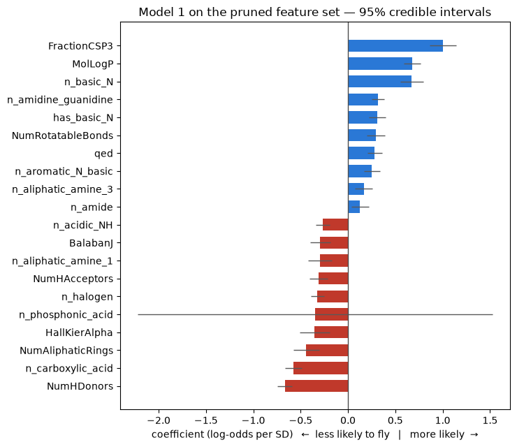
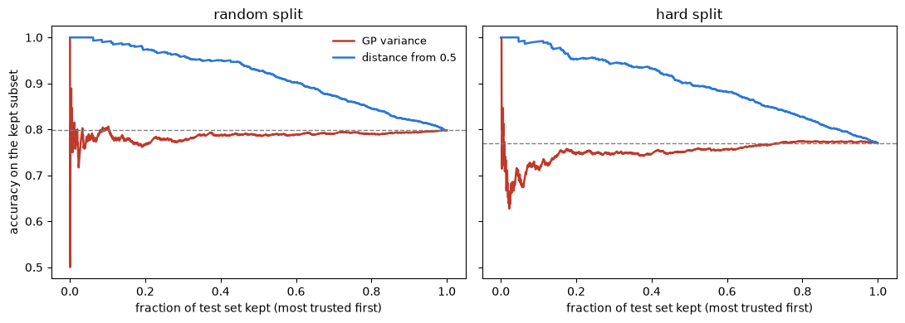
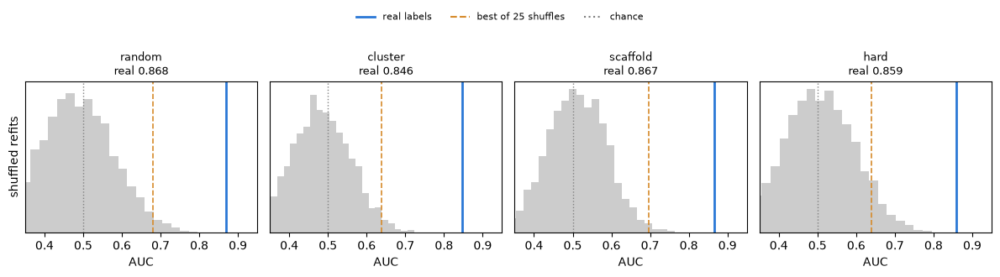

# Will It Fly? Predicting Echo-MS detectability from chemical structure

CSE 5015 course project · Arno Yu

A mass spectrometer only weighs molecules that carry a charge. In positive-ion mode a compound
has to pick up a proton to be seen at all, and whether it does is a property of its structure:
basic nitrogens help, acids hurt. A compound that gives a clear peak is said to **fly**.

This project predicts flying from structure as a *calibrated probability* — not just a ranking,
but a number a chemist can act on, with uncertainty that is honest about what the model does
not know. Three Bayesian models, one dataset of 11,353 compounds measured on an Echo-MS.

**The headline result is that calibration, not accuracy, is what separates these models.** Every
candidate ranks about equally well (AUC 0.845–0.891). They differ by a factor of three in
whether their stated probabilities are true.

---

## Choosing the features first

A model can only be as good as what it is shown, so the cheap model went first: a random forest
over every combination of three feature blocks — 50 interpretable chemistry features (SMARTS
counts for ionisable groups plus RDKit descriptors), 41 XenoSite phase1 descriptors from the
Swamidass lab, and 2048-bit Morgan fingerprints.

| Feature set | Columns | AUC (random) | AUC (cluster) |
|---|---|---|---|
| phase1 | 41 | 0.834 | 0.819 |
| chemistry | 50 | 0.846 | 0.838 |
| Morgan | 2048 | 0.863 | 0.838 |
| chemistry + phase1 | 87 | 0.862 | 0.844 |
| **Morgan + chemistry** | 2098 | **0.885** | **0.866** |
| all three | 2139 | 0.877 | 0.854 |

**Morgan + chemistry wins**, and the two blocks are complementary rather than redundant: the
fingerprints carry structure the descriptors cannot name, the descriptors carry ionisation
chemistry the fingerprints cannot express. Adding phase1 on top makes things worse — those
descriptors were built to predict *metabolism*, which atom a liver enzyme attacks, and say
nothing about whether a molecule holds a proton. (Method notes revisit how safe that screen is.)

So Morgan + chemistry is the feature set to beat, and where it can be used it is what the
models below are given. Model 3 is the exception: a Tanimoto kernel is defined on bit vectors,
so continuous descriptors cannot enter it at all.

---

## Results

Held-out test set, ammonium formate. Higher is better except for log loss and ECE. **Compare
only within a block** — a model and the features it is given cannot be judged separately, and
the three blocks are three different questions.

#### Morgan + chemistry — the feature set the screen chose

| Model | AUC | MCC | log loss | ECE |
|---|---|---|---|---|
| Random forest | 0.885 | 0.593 | 0.472 | 0.107 |
| Model 2 — censored (Tobit) regression | 0.878 | 0.590 | 0.449 | **0.046** |
| Model 1 — Bayesian logistic regression | 0.891 | 0.597 | 0.418 | **0.034** |

#### chemistry only (50 features) — the interpretable set

| Model | AUC | MCC | log loss | ECE |
|---|---|---|---|---|
| Random forest | 0.846 | 0.511 | 0.486 | — |
| Model 2 | 0.849 | 0.514 | 0.490 | 0.049 |
| Model 1 | 0.868 | 0.577 | 0.455 | **0.028** |

#### Morgan only (2048 bits) — the only set a Tanimoto kernel accepts

| Model | AUC | MCC | log loss | ECE |
|---|---|---|---|---|
| Random forest | 0.863 | 0.564 | 0.509 | — |
| Model 2 | 0.845 | 0.515 | 0.499 | 0.051 |
| Model 1 | 0.862 | 0.550 | 0.468 | 0.035 |
| Model 3 — GP, Tanimoto kernel | 0.879 | 0.595 | 0.455 | 0.072 |

Only ECE is emboldened, and only because cross-validation (below) shows the AUC differences
*inside* a block are smaller than the fold-to-fold spread. One split cannot separate these
models on ranking. It can separate them on calibration. A forest has no ECE entry on the two
narrower sets because those runs predate the measure; the Morgan + chemistry row has it, and it
is the row that matters.

**ECE** (expected calibration error) is the average gap between the probability a model
announces and the frequency it achieves. 0.028 means that when the model says 70%, the truth is
within about three points. AUC cannot measure this — it only sees ranking, and a forest's vote
share is not a probability at all.

**Like for like, the forest ranks marginally better and is badly calibrated.** On identical
features the single split above has Model 1 at 0.891 against the forest's 0.885 — but that gap
does not survive cross-validation, which reverses it to −0.005 ± 0.009 with the forest ahead in
7 folds of 10. On ranking these two are the same model to within noise.

Calibration is not close. The forest's ECE is 0.106 against Model 1's 0.050 and Model 2's
0.041, and Model 1 beats it in **10 folds out of 10**. A forest's vote share was never a
probability; the Bayesian models' is.

**The blocks are why Model 3 is not the winner it looks like.** Its 0.879 sits above Model 1's
0.868 — but those are different blocks, and the forest rows show Morgan fingerprints alone are
worth about +0.017 AUC over the chemistry features alone. The lead is the features. Inside its
own block Model 3 does beat both others on ranking, and loses to both on calibration.


Five-fold cross-validation inside each training set, on Morgan + chemistry — the feature set the
screen chose, so the error bars belong to the headline numbers rather than to a side experiment.
Pairing fold by fold cancels the difficulty each fold shares between models:

| Model 1 minus | AUC | ECE | folds Model 1 wins |
|---|---|---|---|
| Random forest | −0.005 ± 0.009 | **−0.053 ± 0.015** | 3/10 on AUC, **10/10 on ECE** |
| Model 2 | +0.005 ± 0.004 | +0.009 ± 0.017 | 9/10 on AUC, 2/10 on ECE |

**This overturns the single-split reading.** On one split Model 1 looked 0.006 ahead of the
forest; across ten folds the forest is 0.005 ahead, and the spread is twice either number. The
ranking difference was noise, and it took the folds to see that.

What is not noise is calibration: 10 folds out of 10, by about half the error. And Model 2,
which ranks slightly behind Model 1, is the best-calibrated of the three (ECE 0.041) — modelling
the peak area and deriving the probability from it beats modelling the yes/no answer directly.

So the honest summary is not *the Bayesian models predict better*. It is: **they predict about
as well and they know what they know.** For a screen deciding which compounds are worth running,
the second property is the one worth paying for.

(The same comparison on the 50 chemistry features alone, across all four splits, puts Model 1
ahead on both counts — 20 folds of 20 on AUC. Narrow feature sets suit the linear model; wide
ones suit the forest. `data/processed/validation_cv.csv` holds both.)

---

## Three findings

### 1. The chemistry the model learns is the chemistry we expected



Model 1's coefficients with 95% credible intervals. Basic nitrogens, lipophilicity and sp³
character push a molecule towards flying; hydrogen-bond donors and carboxylic acids push against
it. That is the textbook account of positive-mode ionisation, recovered from data.

The credible intervals carry information a point estimate cannot. `n_phosphonic_acid` spans
−2.2 to +1.5 — the library holds too few phosphonic acids to say anything about them. A random
forest would report an importance for that feature and give no hint that it is meaningless.

### 2. The GP is the worst-calibrated model of the three

On its own feature set Model 3 ranks well — 0.879 AUC, the best of anything fitted on Morgan
fingerprints alone — but its ECE of 0.072 is nearly three times Model 1's, the worst of the
three models. The probabilities sit too close to 0.5 to be taken at face value.

The cause is the Laplace approximation for GP classification understating the magnitude of the
latent function, and the model can be made to show this. MacKay's approximation squashes the
latent mean through a logistic sigmoid, matching the likelihood the GP was fitted with. Swapping
in a probit — a steeper curve, and the wrong one — *improves* the log loss, 0.455 to 0.435,
because a steeper link compensates for latent values that are too small. A correctly specified
model has no such slack to exploit. The reported numbers use the logistic link throughout.

(Model 3's 0.879 was the project's best AUC until Model 1 was given the same features the forest
preferred, which took it to 0.891. The GP's edge was the fingerprints, not the kernel.)

### 3. The applicability-domain claim does not survive contact with the data



**How to read this**, right to left. The question it answers is the practical one: *I can only
afford to run some of these compounds — can the model tell me which calls to trust?* At the
right edge nothing is discarded and accuracy is 80%, the grey line. Moving left discards the
predictions the model is least sure of, keeping only the most trusted. **A trust signal that
works makes the line climb**: fewer compounds kept, higher accuracy among those left.

The proposal assumed a GP's predictive variance would be that signal, and would hand us an
applicability domain for free: unfamiliar molecule, larger variance, less trustworthy
prediction. **It does not.** Filtering by GP variance (red) leaves accuracy flat at 80% all the
way across — discarding the "uncertain" nine tenths buys nothing. Correlation between variance
and error is −0.09 to −0.02 across four splits.

The claim has two links and only the first holds. GP variance does track *novelty* — it is a
working stranger-detector. But on this task novelty is not what makes a prediction wrong, and
that is the link that fails. Plausibly the unusual molecules are unusual *because* they carry
an extreme group — a quaternary ammonium always flies, a sulfonic acid never does — which makes
them strange and easy at once.

Something else does work: **distance from 0.5** (blue), which climbs to nearly 100%. When the
model says 95%, it is right; when it says 52%, it is guessing, and it says so. Keeping the most
confident fifth gives about 97% accuracy against 60% for the least confident. So the proposal's
question — *when should I trust this?* — has a good answer; it is simply not the one assumed.

(The jitter at the far left is small numbers: past x = 0.02 only a few dozen compounds remain
and one mistake moves the percentage several points.)

Part of the reason is the dataset. Clustering at 0.4 Tanimoto leaves 7,067 clusters among
11,353 compounds, 4,583 of them singletons. Random, cluster, scaffold and deliberately-hard
splits all land within 0.01 AUC of each other. **This library has no genuinely out-of-domain
corner to fail on**, so it cannot demonstrate an applicability domain either way.

---

## Validation



Y-randomization: shuffle the training labels, refit, score against the real test labels, 25
times per split. The shuffled fits average 0.49 — chance — and the luckiest of 25 reaches 0.70,
while the real model scores 0.85–0.87. Four to five standard deviations clear. Whatever the
model learnt is in the labels, not in the plumbing.

The spread matters as much as the mean here: 50 free coefficients fitted to noise can land on a
direction that correlates with the truth by luck, which is why the check compares against the
best of 25 rather than the average.

**Laplace against MCMC.** Models 1 and 2 were fitted both ways — Laplace approximation and NUTS
(nutpie, 4 chains, 1000 draws). Sixteen runs, **zero divergences**, r̂ ≤ 1.006, and predictions
agreeing to within 0.001 AUC. Laplace takes a second where MCMC takes five minutes, so the fast
approximation is used throughout with the sampler as the audit.

**ARD earns its place exactly where there is dead weight to remove.** Against a fixed Gaussian
prior, on the random split:

| Features | | Gaussian | ARD | |
|---|---|---|---|---|
| chemistry (50) | Model 1 | 0.868 / 0.456 | 0.868 / 0.455 | no difference |
| Morgan 2048 | Model 1 | 0.832 / 0.582 | 0.862 / 0.468 | **+0.030 AUC** |
| Morgan + chemistry | Model 1 | 0.854 / 0.574 | **0.891 / 0.418** | **+0.037 AUC** |
| Morgan + chemistry | Model 2 | 0.861 / 0.477 | 0.878 / 0.449 | +0.017 AUC |

(AUC / log loss.) On 50 hand-picked features ARD changes nothing, because none of them are
useless — a fair prior and a learnt one agree. On 2048 fingerprint bits, most of which are
noise for this task, learning a scale per feature is worth more than any other single choice in
the project. Calibration moves even further: ECE 0.100 → 0.034.

This is the proposal's step 3 — *ARD priors instead of stepwise selection* — doing what it was
chosen for. Shrinking a useless coefficient towards zero while leaving its credible interval
wide is not the same as deleting the feature, and it costs one fit rather than hundreds.

ARD lifts Model 2 by less than half as much, and it stays behind Model 1 on identical features
(0.878 against 0.891). So the censored model's gap is the model, not a missing prior — which is
what it took running both to establish. Model 2 earns its keep elsewhere: it predicts the area
itself, so a change of threshold costs no refit, and its RMSE improves from 0.590 to 0.541.

Getting there needed an **analytic Hessian**. The first implementation took it by finite
differences — 2(d+2) gradient evaluations, about 80 s at d = 2098, which made each ARD fit
(twenty of them) half an hour and put the experiment out of reach. Every coefficient enters only
through `mu = A @ beta`, so the whole block is `A' diag(h) A` for one scalar per row: 0.7 s
instead of 80, with the two agreeing to 2e-11 on randomised tests including the no-censoring
and heavily-censored edges.

---

## Reproducing

Data is not in the repository. It is public, and the download script verifies MD5s:

```bash
python -m venv .venv
.venv/Scripts/activate                   # Windows;  source .venv/bin/activate elsewhere
pip install -r requirements.txt
python scripts/download_data.py          # Zenodo record 21450795
```

Then, in order:

```bash
python scripts/featurize.py              # 3 feature blocks, ~6 min
python scripts/add_hard_split.py         # scaffold and hard splits
python scripts/fit_model1.py             # Laplace + MCMC, ~25 min
python scripts/fit_model2.py
python scripts/fit_model3.py             # GP, ~30 min
python scripts/validate.py               # MCC, ECE, Y-randomization, CV
python scripts/export_figures.py
```

Only `featurize.py` needs anything extra: its XenoSite descriptor block reads ONNX weights from
`weights/onnx`, which are not public. The other two feature blocks, and all three models, run
without them. Every notebook is committed **with its outputs**, so all figures and tables can be
read without running anything at all.

### Layout

| Path | What |
|---|---|
| `notebooks/01_data_curation.ipynb` | curation, labels, censoring, the four frozen splits |
| `notebooks/02_baseline_rf.ipynb` | feature cleanup, random forest baselines |
| `notebooks/03_model1_logistic.ipynb` | Model 1, coefficients, Laplace vs MCMC |
| `notebooks/04_model2_censored.ipynb` | Model 2, measurement-noise prior, any-threshold prediction |
| `notebooks/05_model3_gp.ipynb` | Model 3, applicability domain |
| `notebooks/06_validation.ipynb` | comparison table, Y-randomization, cross-validation |
| `scripts/` | the fitting and validation code the notebooks call |
| `figures/` | every figure as a standalone PNG |

---

## Method notes

**Labels.** Peak areas form one smooth distribution with no natural break, so "flies" is a
threshold we choose: area > 10,000, which reproduces the reported pass rates (52.9% formate,
78.6% fluoride). The 362 zeros are *not* measurements of zero — they are "no peak found", and
Model 2 treats them as left-censored rather than pretending to a value.

**Splits.** 20% held out, four ways: random, by cluster (0.4 Tanimoto), by Bemis–Murcko
scaffold, and a deliberately hard split taking the 20% least similar to the rest of the library.
Stereoisomers are kept together throughout, so a pair never straddles train and test.

**Measurement noise (Model 2).** Fitted from 2,444 groups of replicate control wells in the same
data release — different compounds, so no training data is reused. Noise grows as signal falls:
σ = 0.033 at log₁₀ area 5, 0.078 at log₁₀ area 2. Keeping this apart from the model's own error
is what lets the detection probability be recomputed for any threshold without refitting.

**How safe is the feature screen?** The table above rests on one model's judgement, and a forest
has no way to ignore a feature block that is mostly noise — which is precisely what ARD does,
and ARD turned out to be worth +0.037 elsewhere. So "phase1 hurts" is really "phase1 hurts a
forest". Whether it holds anything once ARD can discount it is an open question this project did
not settle; the fit costs two minutes. The chemical argument — descriptors built for metabolism,
not ionisation — still says it will not, which is why the question stayed open rather than
becoming a priority.

---

## References

1. Zhang H, et al. *Acoustic ejection mass spectrometry for high-throughput analysis.* Anal. Chem. (2021).
2. Simpkins S, et al. *Data release: Building the OpenADMET data engine.* Zenodo 21450795 (2026).
3. Ralaivola L, Swamidass SJ, Saigo H, Baldi P. *Graph kernels for chemical informatics.* Neural Networks 18, 1093–1110 (2005).
4. Rasmussen CE, Williams CKI. *Gaussian Processes for Machine Learning.* MIT Press (2006).
